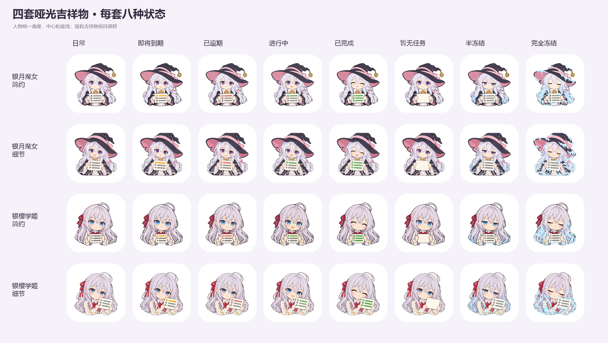

# 哑光吉祥物套装

在“设置 → 吉祥物”中新增四个可选套装，每套都有八种状态：



| ID（保存后不可改名） | 名称 |
| --- | --- |
| silverwitchsimple | 银月魔女·简约 |
| silverwitchdetail | 银月魔女·细节 |
| silverstudentsimple | 银樱学姬·简约 |
| silverstudentdetail | 银樱学姬·细节 |

角色以用户确认的四张哑光日常图为母图。简约版使用较少的发束和衣饰线条；细节版保留辫子、蝴蝶结、帽带纹样等。两版均避免头发亮斑、眼睛反光点、鼻尖高光和饰品金属反光，维持可爱的 Q 版贴纸画风。

| 原图 | 状态 | 表情和纸面 |
| --- | --- | --- |
| 01_daily | 日常 | 微笑，三行灰色条目 |
| 02_due_soon | 即将到期 | 轻微担心，第一行琥珀色感叹号及横条 |
| 03_overdue | 已逾期 | 焦虑眉和小汗滴，第一行红底白叉及红横条 |
| 04_progress | 进行中 | 有干劲，第一行绿底白勾及绿横条 |
| 05_complete | 已完成 | 闭眼笑，三行绿底白勾及绿横条 |
| 06_no_tasks | 暂无任务 | 放松微笑，手持同一张空白纸 |
| 07_half_frozen | 半冻结 | 半眯眼，发梢、衣袖和纸角少量哑光霜边 |
| 08_frozen | 完全冻结 | 困倦闭眼，更明显的哑光霜层，纸上三行仍可见 |

同一套的纸张尺寸、倾斜角、握持姿势和人物占比以该套日常母图为准。导出时整体等比缩放和移动，统一人物高度、底线和水平中心，不拉伸或单独改变五官。各套的 512×512 无损 WebP 同时用于账号头像和桌面图标。头像继续随任务状态变化；桌面入口沿用退到后台时切换的机制。

新增的 32 个 launcher alias 默认全部关闭。旧套装的 ID、顺序、图片、入口名称、默认选项和状态判定保持原样，升级后保留用户原来的选择。

## 资源处理

使用内置 imagegen，以每套日常母图为唯一角色参考，每种状态单独生成。提示词要求只改变表情、纸上对应行和冻结覆盖；保留人物、服装、纸张位置、两个手和透明背景。新增资源的几何配置在 `mobile/tools/mascot_matte_layout.json` 中，完整 PNG 原图另存本地素材包，不随 APK 打包。

```powershell
python mobile/tools/normalize_mascot_layout.py <原图根目录> <归一化输出目录> --layout mobile/tools/mascot_matte_layout.json
python mobile/tools/mascot_assets.py silverwitchsimple <归一化输出目录>/silverwitchsimple
python mobile/tools/mascot_assets.py silverwitchdetail <归一化输出目录>/silverwitchdetail
python mobile/tools/mascot_assets.py silverstudentsimple <归一化输出目录>/silverstudentsimple
python mobile/tools/mascot_assets.py silverstudentdetail <归一化输出目录>/silverstudentdetail
```

现有的 `MascotSetsTest` 会检查全部套装八种状态的图片、头像、两档自适应图标与 manifest 一致，默认只有经典猫娘日常入口启用。切换计划测试覆盖每套每种状态，只允许对应的一个桌面入口启用。

本分支只准备素材和 Android 集成，版本号由后续发版统一调整。
